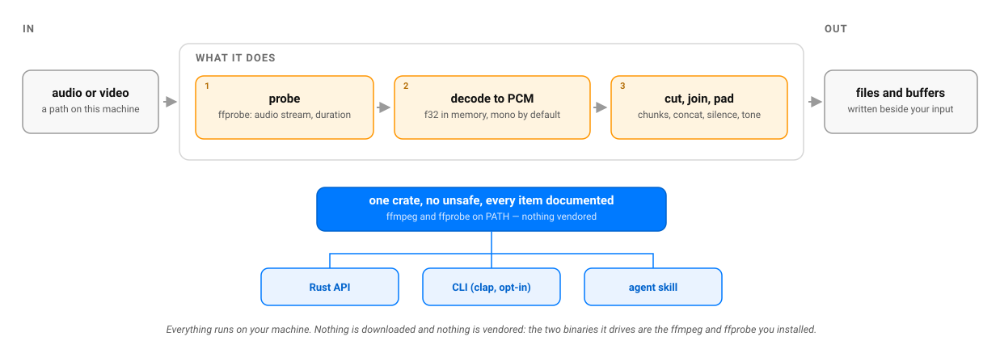

# Audio Helper (Rust)

[🇫🇷](https://github.com/warith-harchaoui/audio-helper-rs/blob/main/LISEZMOI.md) · [🇬🇧](https://github.com/warith-harchaoui/audio-helper-rs/blob/main/README.md)

[](https://crates.io/crates/audio-helper-rs) [](./LICENSE)

Rust rewrite of [`audio-helper`](https://github.com/warith-harchaoui/audio-helper). Same promise, file-level audio utilities on top of `ffmpeg`/`ffprobe` — not a line-by-line port of the Python code, idiomatic Rust throughout.

## Scope

| Function | What it does |
|---|---|
| `is_valid_audio_file(path) -> bool` | `ffprobe`-based check: does the file contain at least one audio stream? |
| `get_audio_duration(path) -> Result<f64>` | Duration in seconds, via `ffprobe`. |
| `convert(input, output, &ConvertOptions) -> Result<()>` | Re-encode at a given sample rate / channel count / codec. `overwrite: false` skips the work if a valid output already exists. |
| `load(path, &LoadOptions) -> Result<PcmBuffer>` | Decode into memory as `f32` PCM (`Vec<f32>` + sample rate + channels) — mono by default, optional resampling. Works on any `ffmpeg`-readable input, including the audio track of a video container. |
| `save(&PcmBuffer, path) -> Result<()>` | Write PCM back to a file, the inverse of `load`. A `.wav` is written directly (no `ffmpeg` needed); any other extension goes through `convert`, so the codec follows the extension. Samples beyond `-1.0..=1.0` are clamped, not wrapped. |
| `extract_chunk(input, start, end, output) -> Result<()>` | Cut a `[start, end)` slice (seconds). |
| `generate_silence(duration, output, sample_rate) -> Result<()>` | Write a silent file of a given duration; self-checks that the result really is silent. |
| `concatenate(inputs, output) -> Result<()>` | Join files head-to-tail via `ffmpeg`'s `concat` filter (works across mismatched codecs, unlike the `concat` demuxer). |
| `mix_room_tone(input, output, &RoomToneOptions) -> Result<()>` | Mix a constant low-level colored-noise bed under a speech track — standard post-production trick so edited-together silent gaps don't sound unnaturally dead. |
| `split_regularly(input, output_dir, chunk_seconds, ext, suffix) -> Result<Vec<PathBuf>>` | Cut a file into fixed-duration chunks. A trailing remainder under 1 second is dropped, unless it is the only chunk. |

```rust
use audio_helper_rs::{get_audio_duration, silence::generate_silence};

let path = std::env::temp_dir().join("example.wav");
generate_silence(1.0, &path, 16_000)?;
println!("{} seconds", get_audio_duration(&path)?);
```

### Not ported

- **`separate_sources`** (Demucs source separation): needs a real ML stack (`torch`/`torchaudio`), disproportionate to this crate's promise. Same call as `youtube-helper-rs` not reimplementing `yt-dlp` itself — a v0.1 that shells out to a Python/Demucs process, rather than a native Rust reimplementation, would be the natural next step if this is ever needed here.
- **`sound_resemblance`** (MFCC-based similarity score): specialized DSP (mel filter banks, MFCC) that belongs in its own crate rather than bolted onto file-level utilities.
- **`load`/`save` round-tripping through `torch.Tensor`/`np.ndarray`**: this crate returns a plain `Vec<f32>` — no tensor library dependency for a library crate. The round trip itself is here: `save` is the inverse of `load` (added in 0.2.0).

## How it works



## Which encoder, and who decided

A compressed output has to be encoded by *something*, and the right something is
machine-dependent. There is no GPU path worth having for audio — a GPU decodes video, and an
audio stream is far too small to pay for the trip across the bus — but the operating system's
own codec layer is real and is backed by dedicated silicon on recent machines:

| platform | what it offers | ffmpeg names it |
|---|---|---|
| macOS / iOS | AudioToolbox | `aac_at`, `alac_at` |
| Windows | Media Foundation | `aac_mf`, `mp3_mf` |
| Linux and the rest | no OS codec layer | ffmpeg's own encoders, SIMD-accelerated (AVX2, NEON) at runtime with no flag to set |

So `convert` no longer lets ffmpeg fall back to its portable default. It asks this machine
which installed encoder is fastest, by **timing them** on ten seconds of signal, and remembers
the verdict in the OS cache directory, keyed by the ffmpeg build — so the question is asked
once per machine, not once per call.

It is measured rather than reasoned because reasoning about accelerators is unreliable: the
sibling crate `vocal-helper-rs` put the obvious accelerator first and made its workload twice
as slow. And the measurement here earns its keep by producing an *unexciting* answer. On this
Apple Silicon machine, over 600 s of audio and three runs each:

| encoder | runs |
|---|---|
| `aac` (ffmpeg's own) | 3.55 s · 3.22 s · 3.11 s |
| `aac_at` (AudioToolbox) | 2.92 s · 3.33 s · 3.26 s |

The ranges overlap: **the platform encoder is not meaningfully faster here**, whatever one
might have assumed. That is why a later candidate must beat the incumbent by more than 5 % to
displace it — otherwise the verdict, which is then cached, would be a coin toss made
permanent. Where the difference is real, the measurement decides; where it is not, the
documented preference order stands.

**An explicit choice always wins, and is never measured or second-guessed:**

```sh
audio-helper-rs convert in.wav out.m4a --encoder aac_at   # this one, because I said so
AUDIO_HELPER_ENCODER=aac audio-helper-rs convert in.wav out.m4a   # pinned, without touching code
```

```rust
let options = ConvertOptions { encoder: Some("libmp3lame".into()), ..Default::default() };
// And to report the decision rather than wonder about it:
let choice = audio_helper_rs::convert::chosen_encoder(&output, &options);
```

The CLI prints which encoder ran and on whose authority (`Explicit`, `Measured`, `Remembered`
or `Sole`), because a tool that silently swaps in a platform codec is a tool whose runs cannot
be compared.

## Installation

Requires `ffmpeg` and `ffprobe` on `PATH` (macOS: `brew install ffmpeg`), and Rust 1.88 or newer.

```toml
[dependencies]
audio-helper-rs = "0.2"
```

## Command line

`cargo install audio-helper-rs` also installs a `audio-helper-rs` binary — named after the
crate, not after the Python twin's `audio-helper`, so the two coexist on one `PATH`
without either silently shadowing the other.

```bash
audio-helper-rs probe recording.m4a
audio-helper-rs convert recording.m4a speech.wav --sample-rate 16000 --channels 1
audio-helper-rs split speech.wav -o pieces --seconds 30
```

Success prints the result on stdout and exits `0`; failure prints one line on
stderr, prefixed `audio-helper-rs: `, and exits `1`. Every flag and every failure mode:
[`skills/audio-helper-rs/references/cli-reference.md`](skills/audio-helper-rs/references/cli-reference.md).

## Agent skill

`skills/audio-helper-rs/` packages this crate as a **Claude Skill** and an **OpenCode
skill**, so an agent can discover it and use it on the user's behalf.
Installation for both hosts is in [`skills/README.md`](skills/README.md).

Its trigger catalogue is enforced, not decorative: [`TRIGGERS.md`](TRIGGERS.md)
is the user-facing catalogue, `references/triggers.md` is its agent-facing
mirror, and `tests/skill.rs` fails `cargo test` — and therefore the pre-push
hook — if the two drift apart, if the skill's `description` exceeds the
published 1024-character cap, if its `name` stops matching its folder or if it
points at a reference that no longer exists.

## Project status

- `cargo build`: clean, no warnings.
- `cargo test`: **26 unit tests + 1 doctest passing**, 0 failures — every test that needs one runs a real `ffmpeg`/`ffprobe` subprocess against a `hound`-generated WAV fixture, nothing mocked. Without `ffmpeg` installed those tests skip with a printed reason instead of failing; under CI (`$CI` set) they fail loudly, because there a missing `ffmpeg` means the workflow is broken.
- `cargo clippy --all-targets`: clean, no warnings.
- **Measured code coverage** (`cargo llvm-cov`, re-measured 2026-10-02 for 0.2.0): **91.19% line coverage** (795 lines, 70 uncovered), 87.06% function coverage, 91.41% region coverage. Per-file breakdown:

  | File | Line coverage |
  |---|---|
  | `chunk.rs` | 90.00% |
  | `concat.rs` | 86.79% |
  | `convert.rs` | 94.12% |
  | `ffmpeg.rs` | 82.14% (the `MissingBinary` branch needs `ffmpeg` actually absent from `PATH` to exercise, which is exactly the case the test suite now skips rather than fails on) |
  | `pcm.rs` | 97.85% |
  | `probe.rs` | 83.04% (ffprobe JSON edge cases — a stream reporting no `duration` at all — aren't fixture-able without a corrupt file) |
  | `roomtone.rs` | 91.04% |
  | `silence.rs` | 88.10% |
  | `split.rs` | 95.00% |

  To reproduce:

  ```bash
  # once: LLVM tools (this project uses Homebrew LLVM, not rustup)
  export LLVM_COV=/opt/homebrew/opt/llvm/bin/llvm-cov
  export LLVM_PROFDATA=/opt/homebrew/opt/llvm/bin/llvm-profdata

  cargo llvm-cov --summary-only        # text summary
  cargo llvm-cov --html                # HTML report at target/llvm-cov/html/index.html
  ```

## Checks before pushing

```bash
scripts/install-hooks.sh   # once per clone: installs the pre-push gate below
cargo fmt --all --check
cargo clippy --all-targets -- -D warnings
cargo test --all
scripts/check-fresh-resolve.sh   # builds with no Cargo.lock, like a downstream consumer
```

The last one exists because the other three, and CI, all build against the committed
`Cargo.lock` — which no consumer of the published crate ever sees. A dependency range that
has gone bad stays green here while breaking every fresh `cargo add` / `cargo install`, and
`cargo publish --dry-run` doesn't catch it either (it verifies with the same lock). CI runs
this check once, on Linux.

## Related

Part of the same author's local-first tooling as [`audio-helper`](https://github.com/warith-harchaoui/audio-helper) (Python), [`podcast-helper-rs`](https://github.com/warith-harchaoui/podcast-helper-rs), [`capture-helper-rs`](https://github.com/warith-harchaoui/capture-helper-rs), [`youtube-helper-rs`](https://github.com/warith-harchaoui/youtube-helper-rs), and the [AI Helpers](https://github.com/warith-harchaoui/ai-helpers) suite. Independent rewrite, not a binding.

## License

BSD-3-Clause, see [LICENSE](LICENSE).

## Author

[Warith HARCHAOUI](https://linkedin.com/in/warith-harchaoui)
